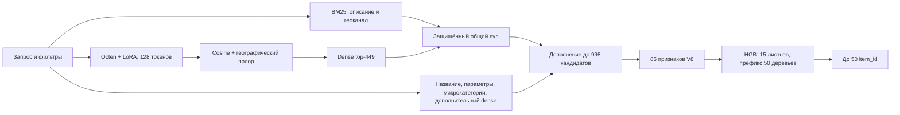

# Поиск объявлений Авито

Локальная система поиска: для каждого запроса из `benchmark_queries.parquet`
она выбирает до 50 идентификаторов объявлений из `benchmark_items.parquet`
и сохраняет `answer.csv`. Целевая метрика — **Recall@50**.

Актуальное состояние документации: **14 октября 2026 года**.

| Что проверено | Результат | Где измерено |
| --- | ---: | --- |
| Последняя сообщённая оценка платформы | **76,3383%** | Скрытый тест, прежняя отправка |
| Лучший текущий исследовательский кандидат | **89,5770% Recall@50** | Tune, доступные положительные объявления, усреднение по текстам |
| Покрытие его пула | **98,5833%**, 998 кандидатов | Тот же Tune и исследовательский каталог |

Последние две строки относятся к отдельному каталогу из **200 000 объявлений**.
Это результат эксперимента, который пока воспроизводится специальными скриптами.
Обычный `avito predict` и экспортёр автономного пакета ещё не поддерживают
его географию перед dense-поиском. Новый внешний результат не получен.

**Навигация:** [быстрый запуск](#быстрый-запуск) ·
[как работает поиск](#как-работает-поиск) · [результаты](#результаты-и-их-смысл) ·
[обучение](#обучение-и-воспроизведение) · [карта проекта](#карта-проекта) ·
[сравнение с первой версией](#что-изменилось-относительно-первой-версии).

## Быстрый запуск

### Установка

Нужен Python **3.11 или новее**; исследования выполнялись в Python 3.12 в WSL.

```bash
python3 -m venv .venv
source .venv/bin/activate
python -m pip install -e .
```

Дополнительные зависимости устанавливаются по задаче:

```bash
python -m pip install -e '.[dense,lora]'       # Эмбеддинги и LoRA-инференс
python -m pip install -e '.[dense,training]'   # Дообучение эмбеддингов
python -m pip install -e '.[lightgbm]'         # LightGBM / LambdaRank
```

Для загрузки сохранённых исследовательских моделей используйте версии из
[`requirements-research-2026-10-12.txt`](requirements-research-2026-10-12.txt):

```bash
python -m pip install -r requirements-research-2026-10-12.txt
python -m pip install -e . --no-deps
```

Данные и веса моделей не включены в Git. Первичная установка и получение весов
требуют интернета. После этого инференс выполняется локально; при полностью
подготовленном HF-кеше можно задать `HF_HUB_OFFLINE=1`.

### Данные

```text
dataset/
├── train.parquet               # Известные выбранные пары и поля объявлений
├── benchmark_items.parquet     # Корпус, из которого разрешено выдавать item_id
└── benchmark_queries.parquet   # Запросы для answer.csv
```

Оригинальные файлы содержат 497 673 строки train, 189 212 объявлений корпуса
и 2 452 benchmark-запроса. В `train.parquet` нет идентификатора поисковой
сессии: для локальной оценки запросы группируются по поисковым полям.

### Создание и проверка answer.csv

Простой запуск BM25 не требует нейросетевых весов:

```bash
avito profile --data-dir dataset --output artifacts/profile.json

avito evaluate --data-dir dataset --method bm25 \
  --split queries --seed 42 --output artifacts/bm25-evaluate.json

avito predict --data-dir dataset --method bm25 --answer answer.csv
avito validate --data-dir dataset --answer answer.csv
```

Это пример обычного CLI, а не команда воспроизведения исследовательских 89,577%.
В `evaluate` явно задавайте `--split queries`: значение по умолчанию — `pairs`.
`--max-queries` пригоден для проверки запуска; итоговые сравнения выполняются
на всей выбранной проверке.

Результат — UTF-8 CSV с запятой и строго двумя колонками:

```csv
query_id,answer
00WuFMaXSFZBxSzT,1382564bf8994a83 121fa7f5e765ce00
```

- Одна строка на каждый benchmark `query_id`, без пропусков и повторов.
- `query_id` сохраняется как строка из 16 символов с исходным регистром.
- В `answer` — до 50 уникальных `item_id` через пробел.
- Каждый `item_id` — исходная строка из 16 символов `0-9a-f` и существует в корпусе.
- Индекс DataFrame и дополнительные колонки не записываются.

`predict` проверяет ответ перед сохранением; отдельный `validate` позволяет
проверить уже готовый файл. Порядок объявлений внутри ответа на Recall@50
не влияет.

### Обычный hybrid на GPU

Перед запуском нужны локальные веса или возможность их однократно скачать:

```bash
avito evaluate --data-dir dataset --split queries --seed 42 \
  --method hybrid --device cuda \
  --embedding-model Octen/Octen-Embedding-0.6B \
  --embedding-batch-size 32 --embedding-max-length 128 \
  --dense-cache artifacts/dense-cache \
  --output artifacts/hybrid-evaluate.json
```

`--embedding-model` также принимает путь к локальному дообученному чекпойнту.
Размер батча влияет на скорость и память; длина текста и формат входа влияют
на представление объявления. HGB-реранкер обучается и оценивается на CPU.

## Как работает поиск

Обычный CLI поддерживает `bm25`, `dense` и `hybrid`. BM25 ищет по названию,
параметрам и описанию, включая дополнительные стеммированные каналы.
Dense использует Sentence Transformers и локальный HNSW-индекс.
Hybrid объединяет каналы через RRF; обучаемый реранкер выбирает финальные 50
из их общего пула.

Последний исследовательский маршрут устроен так:



### Кандидаты и география

Базовый пул объединяет **449 BM25-кандидатов по описанию**, **449 dense-кандидатов**
и **до 100 географических кандидатов**. После удаления повторов свободные места
до лимита **998** заполняются дополнительными маршрутами: названием и параметрами
со смысловыми фильтрами, предсказанными микрокатегориями и более глубоким
глобальным dense-поиском. Исходные кандидаты сохраняются.

Географические BM25-списки выбирают объявления нужных локаций до ограничения
глубины канала. Новый dense-маршрут также учитывает географию **до top-449**:

```text
dense_score = cosine(query, item) + 0.05 × log P(item_location | search_location)
```

Связи локаций обучаются только по fit и сглаживаются расстоянием; масса
сглаживания — 3, масштаб — 40 км, нижняя граница вероятности — 1e-7.
При отсутствии подходящей истории географическая поправка равна нулю.
Жёсткого ограничения одним городом нет. Для этого опыта использованы прежние
векторы объявлений, без нового обучения или кодирования корпуса.

**Вес геоприора `0.05` и финальный `location_bonus=0.02` — разные настройки.**
Первая меняет отбор dense-кандидатов; вторая добавляется к итоговому поисковому
баллу уже найденных объявлений. `ef-search=1000` относится к HNSW-маршрутам;
географический dense top-449 вычисляется по точной cosine всего каталога.

### Эмбеддинги, микрокатегории и признаки

Octen дообучена LoRA на парах «запрос — выбранное объявление». Сохраняются
инструкции query/document модели, длина **128 токенов**, название и категория,
первые 40 слов параметров и первые 48 слов описания. Локация участвует отдельным
географическим сигналом. В проверке pooling и инструкций подтверждённой ошибки
не найдено.

Мягкий классификатор микрокатегорий использует слова, символьные n-граммы
и смысловые фильтры. Для обучения реранкера применяются **три grouped OOF-модели**:
все контексты собственного текста исключены из модели, создающей его признаки.
Микрокатегория даёт вероятность и отдельный поисковый канал, а не жёсткий фильтр.

V8 содержит **85 признаков**: ранги и оценки каналов, RRF, текстовые совпадения,
локацию и категорию, соответствие фильтрам, цену, рейтинг, отзывы, микрокатегорию
и измеренную dense-близость для **каждого** кандидата, включая BM25-only объявления.
Численные dense-признаки сохраняют сырой cosine; dense-ранг отражает геоприор.

HGB обучается на положительных и неразмеченных кандидатах с исходными весами
классов внутри запроса. Невыбранное объявление не считается доказанно нерелевантным.

## Результаты и их смысл

### Сопоставимые этапы текущего Tune

Здесь один каталог из 200 000 объявлений, одни и те же 12 103 контекста / 6 111
текстов. Основная метрика — **text-macro Recall по доступным положительным**:
сначала среднее по контекстам текста, затем по текстам. Для неё доступны
4 750 контекстов / 3 069 текстов. Значения приведены в процентах.

| Этап | Recall пула, % | Recall@50, % |
| --- | ---: | ---: |
| Исходный реранкер V4, HGB-150 | 88,8645 | 81,3442 |
| V8: микрокатегории, новые маршруты, HGB-100 | 90,7148 | 82,8905 |
| Точный cosine без геоприора, прежний HGB-100 | 90,9592 | 83,2000 |
| География перед dense, прежний HGB-100 | 98,5833 | 87,9574 |
| Переобученный географический HGB-50 | 98,5833 | 89,0246 |
| Отдельный опыт `max_features=0.8`, HGB-50 | 98,5833 | 89,3868 |
| **Отдельный опыт `max_leaf_nodes=15`, HGB-50** | **98,5833** | **89,5770** |

Начиная с V8, средний и максимальный пул — **998**. Последние два опыта меняли
ровно один параметр на тех же обучающих строках и оценивались по сохранённым
4 740 500 строкам признаков Tune. Их комбинация не проверялась.

Для `max_features=0.8` прирост над прежним HGB-50 — **+0,3622 п.п.**,
номинальный 95% интервал **[−0,0149; +0,7448]**. Для 15 листьев —
**+0,5524 п.п.**, интервал **[+0,0344; +1,0860]**. Tune уже многократно
использовался; эти интервалы не заменяют независимую проверку.

Лучший кандидат сохранён отдельно:
`artifacts/geo-dense-regularization-2026-10-14/full-tune/hgb-geo005-leaves15-selected50.joblib`.
Файл содержит все 150 обученных деревьев и `selected_iteration=50`.
Потребитель обязан учитывать этот префикс. Прежняя модель автоматически не заменена.

### Доступность объявлений и независимость проверки

Из 12 800 известных положительных пар Tune в исследовательском каталоге
доступны 4 871. **7 353 контекста без доступной цели сохранены** в полных отчётах.
Условная метрика оценивает поиск там, где цель существует в каталоге;
полная метрика учитывает и отсутствующие цели. Для лучшего кандидата полный
text-macro Recall@50 равен **33,5901%**. Это другой знаменатель, а не второй
результат платформы.

Разбиение выполняется по нормализованным текстам. Тексты Tune/Audit исключены
из обучения LoRA, реранкера и fit-статистик; исторически просмотренные тексты
исключены при создании новой когорты. Каталог выбран по хешам без принудительного
добавления правильных ответов. Все контексты и знаменатели сохраняются.

Ранее V8 проверена на Audit: Recall@50 **80,7272% → 82,1323%**, Recall пула
**88,5773% → 89,7411%**. Это замороженная регрессия по уже наблюдавшемуся Audit.
Новая география, переобучение и регуляризация на нём не оценивались.
**89,5770% пока не подтверждены независимой проверкой и не являются внешним score.**

### Контроль переобучения

Географический реранкер подготовлен на 30 000 выбранных группах; положительные
попали в пул у 29 696. Получено **1 935 640 строк**: 35 096 положительных
и 1 900 544 неразмеченных. Индекс, encoder и приоры для опытов регуляризации
сохранялись.

Число деревьев проверяется по Recall на Tune. В географическом HGB переход
50 → 150 снизил Recall **89,0246% → 88,0247%**, хотя train log loss снизился
**0,2462 → 0,2207**. Это признак возможной избыточной сложности. Log loss
не равен проценту ошибочных ответов. При 100 деревьях само переобучение
не дало подтверждённого улучшения над прежним HGB-100.

Для обоих новых вариантов лучший проверенный префикс — 50. У 15 листьев
Recall при 50/75/100/150 деревьях: **89,5770 / 88,9296 / 88,1899 / 88,0011%**.
Уменьшение листьев помогло на этом Tune, но не исключает переобучение вообще.

Точные числа, источники и история находятся в
[`docs/current-results.json`](docs/current-results.json) и
[`docs/EXPERIMENTS.md`](docs/EXPERIMENTS.md).

## Обучение и воспроизведение

### Дообучение Octen

```bash
python scripts/train_embeddings.py \
  --data-dir dataset --output-dir artifacts/octen-lora-new \
  --model Octen/Octen-Embedding-0.6B --seed 42 --max-length 128 \
  --batch-size 32 --mini-batch-size 32 --epochs 1
```

Требуются CUDA и зависимости `.[dense,training]`. Скрипт фиксирует длину 128,
выбирает одну положительную пару на нормализованный текст и исключает отложенные
тексты. У завершённой полной LoRA было **59 140 пар**. Адаптер сохраняется
в `<output-dir>/model`; каталог должен быть новым. Resume и промежуточное
сохранение в этом скрипте не реализованы.

### Реранкер и микрокатегории

Основной CLI содержит `prepare-reranker`, `fit-reranker`, `fit-microcategory`.
Для уже подготовленных обучающих признаков:

```bash
avito fit-reranker --reranker-data artifacts/reranker-train.parquet \
  --reranker-model artifacts/reranker.joblib \
  --reranker-estimator histgb --reranker-max-iter 150
```

`lightgbm` и `lambdarank` — дополнительные варианты, требующие `.[lightgbm]`.
Для LambdaRank нужны группированные обучающие строки. Все настройки поиска,
корпус, схема признаков и priors обучения должны совпадать с оценкой.

Для текущей исследовательской модели используются отдельные скрипты. Полные
команды подготовки, оценки по кешу, файлы моделей и условия повторного запуска
собраны в [`docs/REPRODUCIBILITY.md`](docs/REPRODUCIBILITY.md).
Завершённые результаты защищены от перезаписи; при повторе задаётся новый каталог.

### Что уже можно использовать для benchmark

Обычный `avito predict` создаёт и проверяет `answer.csv` для текущих входных
Parquet-файлов. Для поддерживаемых моделей существует
`scripts/export_offline_solution.py`: он создаёт пакет с локальными весами,
зафиксированными зависимостями и `run_predict.py`.

Последний географический dense-маршрут пока не подключён к этим двум путям.
Новая модель также связана с отпечатком исследовательского каталога, поэтому
для исходных 189 212 benchmark-объявлений нужна отдельная подготовка и проверка
переноса с выбранными настройками. Архив исследовательских результатов
не является готовым генератором новой отправки.

## Карта проекта

| Файл / каталог | Назначение |
| --- | --- |
| `src/avito_candidates/core.py` | Нормализация, ключи запросов, разбиение, Recall и проверка CSV |
| `baseline.py`, `hybrid.py` | BM25 по полям, геоканалы и RRF |
| `dense.py` | Тексты query/document, Octen/LoRA, HNSW и кеш |
| `geo_dense.py` | Точный cosine и геоприор перед dense top-K |
| `microcategory.py`, `supplemental.py` | OOF-микрокатегории и дополнение кандидатного пула |
| `reranker.py`, `cli.py` | Признаки, модели, совместимость и основные команды |
| `scripts/train_embeddings.py` | Дообучение LoRA |
| `scripts/*geo_dense*.py` | Географические исследования, переобучение и регуляризация |
| `scripts/build_fresh_validation_protocol.py` | Протокол Fit/Tune/Audit |
| `scripts/export_offline_solution.py` | Экспорт поддерживаемого автономного инференса |
| `tests/`, `scripts/test_*.py` | Проверки поиска, метрик, provenance и воспроизводимости |
| `docs/` | Описание опытов, источники результатов и инструкции |
| `artifacts/` | Локальные данные исследований, модели и кеши; не включены в Git |

В строках с короткими именами модулей подразумевается `src/avito_candidates/`.
Используются открытые библиотеки pandas, PyArrow, NumPy, scikit-learn,
Snowball Stemmer, Sentence Transformers, PyTorch, PEFT, datasets, hnswlib
и, в отдельных опытах, LightGBM.

Базовые тесты:

```bash
python -m unittest discover -s tests -q
PYTHONPATH=src:scripts python -m unittest \
  scripts.test_train_geo_dense_regularization \
  scripts.test_evaluate_geo_dense_regularization -q
```

## Что изменилось относительно первой версии

Первая рабочая реализация — коммит **`6db6f17`**. Она использовала TF-IDF
по названию и параметрам, три канала истории выборов, по 300 кандидатов
из канала, равные веса каналов и константу RRF 60, дополнение популярными объявлениями.
BM25 появился следующим этапом, в `92dbcfa`.

| Компонент | Первая версия | Что изменено и зачем |
| --- | --- | --- |
| Лексический поиск | Один TF-IDF по названию и параметрам | BM25 по отдельным полям, описание и стемминг для самостоятельных текстовых сигналов |
| История выборов | Прямые списки прошлых ответов на текст / локацию / полный запрос | После первого baseline прямые каналы заменены поиском и обобщающими fit-статистиками |
| Семантика | Не было эмбеддингов | Добавлены E5/HNSW, затем Octen и собственная LoRA для смысла запроса и объявления |
| Текст эмбеддингов | Не применялся | Учтены название, категория, параметры, описание и фильтры; сохранены инструкции модели |
| География | Локация была ключом истории | BM25-геоканалы до отсечения, сохранение точной локации при расширении, затем геоприор до dense top-K |
| Микрокатегории | Не использовались | Статистические признаки, затем мягкий word/char-классификатор с grouped OOF и поисковым каналом |
| Пул | Независимые top-300 списки без текущего бюджета 998 | Защищённое объединение 449+449+100; дополнительные сигналы заполняют свободные места до 998 |
| Финальные 50 | Только RRF и популярность | Обучаемый HGB; проверены также LightGBM classifier и LambdaRank |
| Признаки | Не было обучаемого реранкера | V8 с 85 признаками, включая исходные оценки и dense cosine всего пула |
| Сложность модели | Не требовала подбора | Выбор runtime-префикса по Tune; отдельные опыты числа листьев и доли признаков |
| Валидация | Уже были `pairs` / `queries` и Recall по полным контекстам | Добавлены холодная когорта Fit/Tune/Audit, text-macro, полные знаменатели и парные интервалы |
| Защита от утечки | История строилась только по fit | OOF, исключение собственного текста из priors, сохранение разрешённых текстов и проверка происхождения |
| Воспроизводимость | Уже были CLI, seed и проверка CSV | Добавлены отпечатки корпуса/encoder/моделей, схемы признаков, retrieval-конфигурации и кеш полных пулов |
| Локальная отправка | Уже создавался корректный CSV | Добавлены поддерживаемые offline bundles; перенос последнего геомаршрута ещё предстоит |

Для первой TF-IDF-версии подтверждённый численный Recall в исходной документации
не сохранён, поэтому общий прирост от неё не заявляется. На сопоставимом текущем
Tune последовательность V4 → лучший кандидат дала **81,3442% → 89,5770%**
Recall@50 и **88,8645% → 98,5833%** покрытия пула. Это суммарное изменение
нескольких компонентов, а не изолированный эффект одного признака.

Отдельно сообщённые внешние отправки улучшились **73,6234% → 76,3383%**.
Последние географические и регуляризационные изменения на платформе ещё
не проверены. Подробная история принятых и отклонённых гипотез — в
[`docs/EXPERIMENTS.md`](docs/EXPERIMENTS.md).
