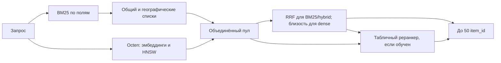
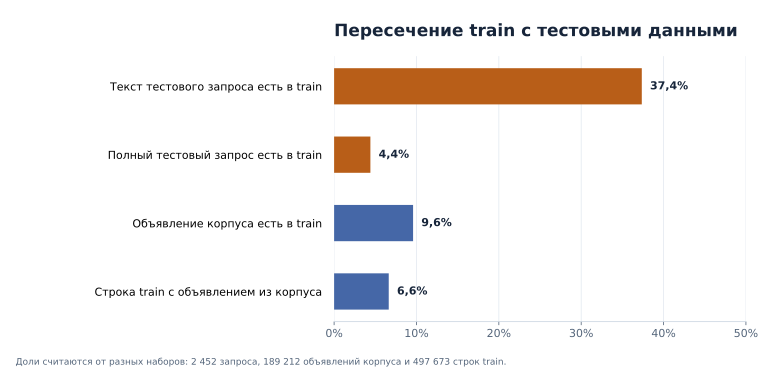
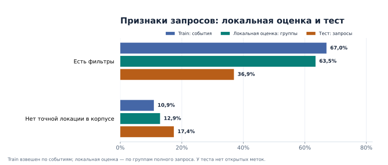
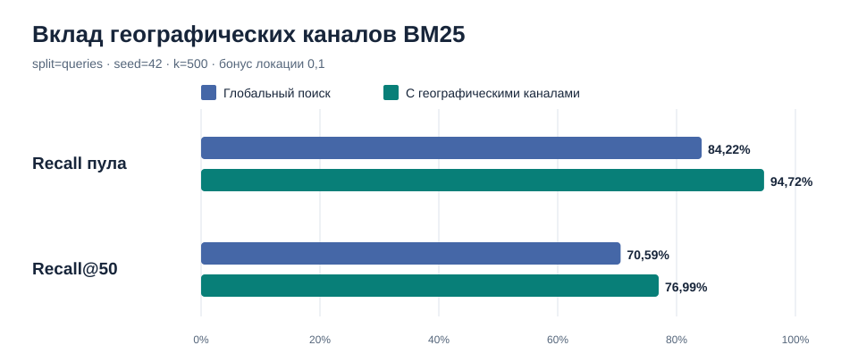
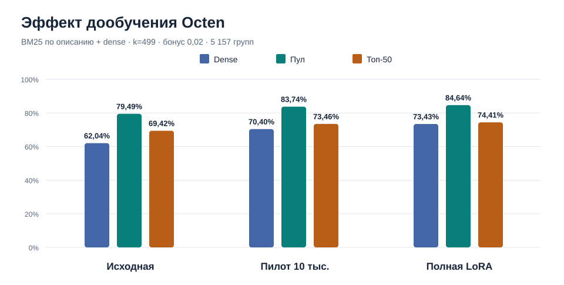
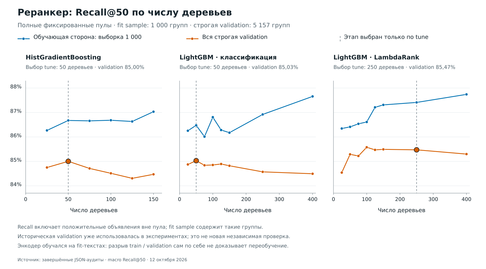

# Поиск объявлений для запросов Авито

Проект решает задачу кандидатогенерации: для каждого поискового запроса нужно
выбрать до 50 объявлений из корпуса. Качество оценивается по Recall@50.

Краткое описание данных, признаков, алгоритмов, проверки и основных ошибок —
в [описании решения](SOLUTION.md).

В проекте есть три режима поиска:

- `bm25` отдельно ищет по заголовкам, параметрам и описаниям;
- `dense` ищет близкие по смыслу объявления с помощью эмбеддингов;
- `hybrid` объединяет BM25-каналы и dense-поиск с помощью RRF.

В ответ попадают до 50 лучших объявлений.

Дополнительно доступен обучаемый табличный реранкер: он выбирает финальные 50
из полного пула BM25, dense или hybrid. Он использует ранги каналов, текстовые
совпадения, совпадение локации и параметры объявления. Реализация построена на
`HistGradientBoostingClassifier` из scikit-learn; она работает локально и не
требует нового внешнего API.



Географические списки отбирают объявления нужной локации **до** ограничения
глубины каждого BM25-канала. Общие списки при этом сохраняются. В режимах
`bm25` и `hybrid` RRF выбирает финальные 50 из объединённого пула; в `dense`
их задаёт близость эмбеддингов. Если включён реранкер, оценки и ранги поиска
становятся его признаками, и он повторно выбирает 50 из того же пула.

Навигация: [описание решения](SOLUTION.md) ·
[данные и результаты](#что-показали-данные-и-эксперименты) ·
[установка](#установка) · [команды](#команды) ·
[карта проекта](#карта-проекта) · [проверка качества](#как-устроена-проверка-качества).

## Что показали данные и эксперименты

### Данные и ограничения проверки

Для локальной проверки используем корпус из 189 212 объявлений
`benchmark_items.parquet` и разбиение `--split queries --seed 42`: все варианты
одного текста запроса остаются по одну сторону разбиения. В train — 497 673
выбранные пары, но только 33 010 из них относятся к этому корпусу. На
отложенной части это 6 837 из 93 616 строк, или 5 157 групп запросов.
В train встречаются лишь 18 142 разных объявления корпуса — 9,6% от него.
Остальные выбранные объявления отсутствуют в проверочном корпусе и в Recall
не участвуют. Локальная оценка полезна для сравнения настроек на одинаковых
данных, но её абсолютное значение нельзя считать прогнозом результата сдачи.



Сами запросы тоже отличаются. У 5 157 локальных групп — 2 431 уникальный
нормализованный текст; у 2 452 тестовых запросов — 2 451. Фильтры заданы у
63,5% локальных групп и 36,9% тестовых запросов. Для 427 тестовых запросов
(17,4%) в корпусе вообще нет объявления с точным `location_id`. Поэтому
запоминать пары из train недостаточно: в нём встречались только 37,4% текстов
тестовых запросов и 4,4% полных сочетаний всех поисковых признаков.
Географию используем как сигнал и добавляем отдельные географические каналы,
сохраняя глобальный поиск. Жёсткое ограничение одним городом потеряло бы
часть подходящих объявлений.



### Кандидаты и география

На одном локальном разбиении BM25 с глубиной 500 и географическими каналами
поднял Recall всего пула с 0,8422 до 0,9472, а Recall@50 — с 0,7059 до
0,7699. Табличный реранкер на том же BM25-пуле дал 0,7955 в отдельном прогоне
на Mac. Бонус `0.1` в **гибридном** RRF с двумя каналами практически
ставит все найденные объявления точной локации выше остальных: максимальный
балл без бонуса равен примерно `2/61 ≈ 0,0328`. Для опытов с дообученной
Octen использовали более мягкий бонус `0.02`; влияние географии и качество
выбора финальных 50 проверяем отдельно.



### Дообучение Octen и итоговая проверка

По отчётам запусков на ПК дообученную Octen сравнивали с исходной моделью
при одинаковых настройках:
BM25 только по описанию плюс dense-поиск, по 499 кандидатов, `ef-search=1000`,
длина 128 токенов, бонус локации `0.02`. Все значения ниже относятся к тем же
5 157 локальным группам:

| Эмбеддинги | Recall пула | Recall dense-канала | Recall@50 |
| --- | ---: | ---: | ---: |
| Исходная Octen | 0,7949 | 0,6204 | 0,6942 |
| LoRA, пилот на 10 тыс. пар | 0,8374 | 0,7040 | 0,7346 |
| LoRA, полное обучение | **0,8464** | **0,7343** | **0,7441** |



Полную модель оставили для следующего этапа: она улучшила и Recall пула, и
итоговые 50 на этой проверке. Затем на расширенном hybrid-пуле с тем же
бонусом `0.02` табличный реранкер поднял локальный Recall@50 с **0,8031 до
0,8199**. Это отдельный эксперимент с другим пулом, поэтому напрямую
сравнивать его с таблицей эмбеддингов нельзя.

### Результат отдельной ветки с новыми признаками

В [ветке `improve-validation-microcat-geo`](https://github.com/Alexeyokey/avitotestproject/tree/improve-validation-microcat-geo)
к реранкеру добавлены признаки микрокатегории и статистики выбора локаций.
Обучение микрокатегорийного признака исключает собственный текст запроса при
подготовке обучающих строк. Отдельный географический поиск по связанным
локациям заполняет только свободные места в пуле до лимита 998: у его списков
нулевой вес RRF, поэтому они доступны реранкеру, но не вытесняют кандидатов
точной локации и глобального поиска при объединении. Классификатор в
описанном эксперименте остаётся `HistGradientBoostingClassifier`. Ветка
также содержит сценарий оценки с перевзвешиванием по наблюдаемым
признакам тестовых запросов; такое перевзвешивание не устраняет смещение
известных положительных объявлений.

В [описании результата ветки](https://github.com/Alexeyokey/avitotestproject/blob/improve-validation-microcat-geo/solution_description.md)
приведено парное сравнение на одном пуле и разбиении по текстам запросов
(`seed=42`, 5 157 отложенных групп):

| Отбор финальных 50 | Локальный Recall@50 |
| --- | ---: |
| Исходный RRF | 0,80313 |
| Прежний табличный реранкер | 0,81985 |
| Реранкер с новыми признаками | **0,84376** |

Относительно прежнего реранкера прирост составил **2,39 процентного пункта**.
В описании ветки указан 95% кластерный bootstrap-интервал для парной разницы
по текстам запросов: **[1,72; 3,11] п. п.** Recall пула — **0,91664**, средний
размер пула — **783,47** объявления. Модель обучалась на 21 392 группах
обучающей части. Эти числа взяты из описания ветки: сами по-запросные отчёты
и веса реранкера в Git не размещены, поэтому независимо пересчитать результат
по опубликованным файлам пока нельзя. Код новой модели остаётся в отдельной
ветке; результат скрытого теста для неё здесь не заявлен.

### Результаты на тестовых запросах

| Отправка на платформу | Recall@50 |
| --- | ---: |
| Первая | 0,736234 |
| Подтверждённый результат из чата | **0,763383** |

Подтверждённый результат выше первого на **2,71 процентного пункта**.
Соответствующий сохранённый `answer.csv` имеет SHA256
`566800f62d515834bd7daf3dd02c7e0f0d6ef80a94f3ea1cff5aef5f4882d1d8`.
Прежняя документация также приводила округлённое 0,764 без привязки к файлу;
этот результат не используется для выбора модели в текущем исследовании.
Скрытые результаты нельзя напрямую сопоставлять с локальными 0,84376.

По одной итоговой метрике для каждой отправки нельзя понять, какая часть
потерь возникла при поиске кандидатов, а какая — при выборе 50 реранкером.
Следующее сравнение нужно делать на одном сохранённом пуле, с реранкером и
без него, отдельно для запросов с фильтрами, без фильтров и без точной
локации. При оценке новых вариантов также будем учитывать распределение
тестовых запросов, а не только среднее по локальным группам.

Числа экспериментов лежат в `docs/readme-results.json`. Графики по данным
пересчитываются из трёх Parquet-файлов. Для их обновления установите
Matplotlib и выполните:

```bash
pip install -e '.[plots]'
python scripts/analyze_dataset_for_readme.py --data-dir dataset
python scripts/plot_dataset_analysis.py
python scripts/render_readme_charts.py
```

### Аудит переобучения, 12 октября 2026

Исходную модель проверили по префиксам деревьев на **одних сохранённых
кандидатах**. Пул: BM25 по описанию 449, dense 449, геоканал 100,
`ef-search=1000`, длина 128, бонус локации 0.02, квота RRF 0;
объединение содержит не больше 998 объявлений. В свежем кэше Recall пула
равен **0.91664**, Recall@50 исходного отбора — **0.80333**.

| Модель | Деревья, выбранные по tune | Recall@50 всех 5 157 групп | Recall@50 confirmation |
| --- | ---: | ---: | ---: |
| HGB | 50 | 0.85002 | 0.84930 |
| LightGBM classifier | 50 | 0.85028 | 0.84681 |
| LightGBM LambdaRank | 250 | 0.85472 | 0.85164 |

HGB на 150 деревьях дал 0.84470. Переход к 50 улучшил Recall@50 на
**0.53 процентного пункта**, парный 95% bootstrap-интервал по текстам
запросов — **[0.15; 0.91] п. п.** При этом взвешенный train log loss
продолжал уменьшаться: 0.2510 на 50 деревьях и 0.2265 на 150.
Это свидетельство избыточной сложности поздних префиксов на этой проверке,
а не «23% ошибок» модели: log loss не является долей неверных ответов.

LambdaRank лучше HGB-150, но преимущество над правильно настроенной HGB-50
на confirmation пока не подтверждено: **+0.23 п. п.**, интервал
**[-0.48; 1.01] п. п.** Выбирать победителя только по общей средней
не следует.

Tune и confirmation разделены по нормализованным текстам; выбор числа
деревьев использует только tune. Однако исторические 5 157 групп уже
участвовали в предыдущих экспериментах, поэтому confirmation нельзя
называть новым независимым тестом. Новый seed не решит эту проблему:
LoRA-энкодер обучался на fit-текстах seed 42, и большинство запросов
другого разбиения уже попадали бы в его обучение. Разница локальной и
скрытой метрик также связана с пересечением положительных объявлений с
корпусом и распределением запросов, поэтому не доказывает переобучение
сама по себе. При перевзвешивании по наблюдаемому составу тестовых запросов
преимущество HGB-50 над HGB-150 уменьшается до 0.24 п. п.; его интервал
включает ноль. Поэтому локальный выигрыш не выдаётся за гарантированный
прирост скрытой метрики.



Новые контролируемые варианты добавляют численную cosine-близость для
**всех** кандидатов объединения, включая BM25-only объявления, и исключают
собственный текст запроса из обучающей геостатистики. Инвентарь объявлений
и эмбеддинги не меняются. Идентификаторы запросов/объявлений записываются
как метаданные групп и не передаются в модель как признаки.

Для выбора направлений просмотрены первичные реализации:
[ranking.py в AvitoDS_Bootcamp_TestTask](https://github.com/boomchik93/AvitoDS_Bootcamp_TestTask/blob/956b6c8f3d2726f1f6f9b95114c5d6dd4f20743f/src/ranking.py#L209-L265)
и [ranker.py в AvitoNLPTest](https://github.com/serzhikWW/AvitoNLPTest/blob/82d12978989e0d6fc767b916f5b43502a9b775a2/src/ranker.py#L161-L241).
Используем собственную реализацию общих методов: численные поисковые
признаки и групповой LambdaRank. Их качество определяется нашими
сопоставимыми опытами, а не результатами чужого решения.

Контролируемая проверка закончена. Для четырёх новых моделей использованы
одни и те же 1 279 571 обучающих строк: 21 779 выбранных объявлений и
1 257 792 неразмеченных кандидата, 19 653 группы с положительным примером
из 21 392 подготовленных. V4-проекция удаляет только два dense-признака;
группы, метки, веса и статистики остаются одинаковыми.

| Исправленная обучающая геостатистика | Полная dense-близость | Модель | Деревья по tune | Все 5 157 | Confirmation |
| --- | --- | --- | ---: | ---: | ---: |
| нет, исходная точка | нет | HGB | 50 | 0.85002 | 0.84930 |
| да | нет | HGB | 25 | 0.85183 | 0.84946 |
| да | нет | LambdaRank | 100 | 0.85404 | 0.84933 |
| да | да | HGB | 50 | 0.85265 | 0.84880 |
| да | да | LambdaRank | 100 | 0.85667 | 0.85178 |

Лучший новый вариант по tune — V6 LambdaRank-100. Его confirmation-прирост
к HGB-50 — **+0.25 п. п.**, интервал **[-0.46; 0.99] п. п.**; надёжного
преимущества не установлено. Переключать основное решение на него по этой
проверке не стали. Варианты сохранены для следующих независимых проверок.

Общий пул имеет SHA256
`0f7be4d2dce6d4b0ec40ed3083b7cc7411fa06f4fc59cc809973da69ecfcadb2`.
Хеш учитывает идентичность/порядок кандидатов, метки и знаменатели Recall,
а не только средний размер. Старый дополнительный dense-балл был dot product
с небольшим отклонением нормы bf16-запросов от единицы. При выводе V6-кэша
норма восстановлена по 449 парным HNSW-баллам каждого запроса; максимальное
расхождение скорректированных косинусов — **5.68e-7**. Прежние 75 признаков
не менялись, объявления повторно не кодировались.

Код и инструменты проверены в фактическом WSL-окружении: **180 тестов**
(94 проекта и 86 исследовательских инструментов). Дополнительно прошли
16 проверок выбора финальной модели и восстановления метаданных старого
отчёта; часть проверок выбора входит в первоначальный набор.

Итоговая HGB-50 уже обучена на всех доступных группах: из 26 549
подготовленных групп 24 399 имеют положительное объявление в пуле.
Обучение использовало 1 588 556 строк: 27 020 выбранных объявлений и
1 561 536 неразмеченных кандидатов. Это новые финальные веса; значение
0.85002 относится к прежней модели обучающей части с выбранным префиксом,
а не к оценке этих весов. Индекс объявлений и дообученная Octen сохранены.

Старый файл модели не содержал хешей обучающих строк и явной политики
обучающих статистик. Для проверки совместимости отдельно сохранён отчёт
`hgb-report-with-policy.json`: SHA модели, метаданные обучающего кэша и
замороженный код подтверждают ожидаемую схему microcategory LOO / full-fit
geography. Это документированный вывод по коду и кэшу, а не независимая
проверка исторических обучающих строк. Новая финальная модель сохраняет
хеши данных и явную политику; исходный отчёт проверки не изменяется.

Готовые JSON-отчёты, кривые и парные сравнения сохраняются в
`artifacts/research-2026-10-12`. Их числа относятся к локальной проверке;
результат нового файла на скрытом тесте можно узнать только после сдачи.
Точно подтверждённый в этом чате скрытый результат — **0.763383**.

## Установка

Нужен Python 3.11 или новее.

Для готовых весов исследования 12 октября используйте **Python 3.12** и
`requirements-research-2026-10-12.txt`: joblib-файлы scikit-learn не являются
универсальным форматом между версиями библиотеки. Этот файл фиксирует
действительно использованное окружение, включая LightGBM и зависимости LoRA.

```bash
python3.12 -m venv .venv
source .venv/bin/activate
pip install -r requirements-research-2026-10-12.txt
pip install -e . --no-deps
```

```bash
python -m venv .venv
source .venv/bin/activate
pip install -r requirements-lock.txt
pip install -e . --no-deps
```

В Windows окружение активируется командой `.venv\Scripts\Activate.ps1`.

Для режимов `dense` и `hybrid` установите дополнительные зависимости:

```bash
pip install -e '.[dense]'
```

Положите `train.parquet`, `benchmark_queries.parquet` и
`benchmark_items.parquet` в папку `dataset`. Вместо этого можно передать
абсолютный путь к папке с данными через `--data-dir`.

## Команды

### Воспроизведение итогового HGB-50

Глубина 50 выбрана по tune на `split=queries, seed=42`. Финальные веса
обучаются после выбора глубины на всех доступных группах, с ограничением
30 000 (в этих данных доступно 26 549). Их нельзя оценивать как независимую
модель на тех же обучающих запросах. Для основного варианта сохраняется
проверенная политика геостатистики; географическая LOO и V6 доступны как
отдельные исследовательские варианты.

При подготовленных локальных весах и HF-кэше:

```bash
export PYTHONPATH=src HF_HUB_OFFLINE=1 OMP_NUM_THREADS=4
CHECKPOINT="$(realpath artifacts/octen-lora-128-full-mb16-s42/model)"
COMMON=(
  --data-dir dataset --method hybrid --device cuda
  --embedding-model "$CHECKPOINT" --embedding-batch-size 32
  --embedding-max-length 128 --embedding-params-words 40
  --embedding-description-words 48 --candidate-k 449 --ef-search 1000
  --title-weight 0 --params-weight 0 --description-weight 0.5
  --stem-title-weight 0 --stem-params-weight 0
  --location-bonus 0.02 --channel-quota 0
  --geo-candidate-k 100 --geo-top-locations 3 --geo-min-history 20 --geo-weight 0.25
)
python -m avito_candidates.cli prepare-reranker "${COMMON[@]}" \
  --split all --seed 42 --reranker-feature-version 4 \
  --max-train-queries 30000 --reranker-negatives-per-query 64 \
  --reranker-data artifacts/final-hgb50/train.parquet
python -m avito_candidates.cli fit-reranker \
  --reranker-data artifacts/final-hgb50/train.parquet \
  --reranker-estimator histgb --reranker-max-iter 50 \
  --reranker-model artifacts/final-hgb50/model.joblib
python -m avito_candidates.cli predict "${COMMON[@]}" \
  --reranker-model artifacts/final-hgb50/model.joblib --answer answer.csv
python -m avito_candidates.cli validate --data-dir dataset --answer answer.csv
```

Готовый автономный пакет запускается через `run_predict.py`: он проверяет
хеши, задаёт локальный HF-кэш и валидирует CSV. Данные предоставляются
отдельно. На новом компьютере потребуется один раз построить локальный
HNSW-индекс; сохранённые веса заново обучать не требуется.

Для аудита используйте `cache_reranker_audit.py`,
`audit_reranker_learning_curve.py` и `compare_audit_models.py`. Весь опыт
V4/V6 повторяет `run_dense_feature_ablation.py`; он сохраняет группы и
кандидатов и выбирает префиксы только по tune.

Запустить тесты:

```shell
python -m unittest discover -s tests -v
```

Посмотреть основные пересечения между обучающей выборкой и бенчмарком:

```shell
avito profile --data-dir dataset --output artifacts/profile.json
```

Проверить качество на отложенных парах «запрос — объявление»:

```shell
avito evaluate --data-dir dataset --split pairs --output artifacts/bm25-pairs.json
```

Проверить качество на отложенных текстах запросов:

```shell
avito evaluate --data-dir dataset --split queries --output artifacts/bm25-queries.json
```

По умолчанию в проверку попадает около 20% строк. `evaluate` читает train
порциями по 32 768 строк и сохраняет в памяти только отложенные ответы,
которые есть в корпусе. Размер порции меняется через `--train-batch-size`.
Долю можно изменить, например:

```shell
avito evaluate --data-dir dataset --split queries --validation-fraction 0.1 \
  --output artifacts/bm25-queries-10pct.json
```

Проверить по всем строкам `train.parquet`, чьи объявления есть в корпусе:

```shell
avito evaluate --data-dir dataset --split all \
  --output artifacts/bm25-all.json
```

Для быстрого пробного запуска можно добавить `--max-queries 200`; это ограничит
число оцениваемых запросов после выбора строк, даже при `--split all`.

Три поля индексируются отдельно и объединяются через RRF. Настройки по умолчанию:

| Поле | `k1` | `b` | Вес |
|---|---:|---:|---:|
| Заголовок | 1.0 | 0.2 | 2.0 |
| Параметры | 1.2 | 0.7 | 1.0 |
| Описание | 1.0 | 0.8 | 0.5 |

Настройки меняются через `--title-k1`, `--title-b`, `--title-weight` и такие же
аргументы с префиксами `params` и `description`. `--k1` и `--b` переопределяют
значение сразу для всех трёх полей. Внутри BM25 используется `--bm25-rrf-k 30`
и квота `--bm25-channel-quota 10`.

Для эксперимента с русским стеммингом включите отдельные каналы заголовка и
параметров объявления. Исходные BM25-каналы при этом остаются включёнными:

```shell
avito evaluate --data-dir dataset --split queries --method bm25 --candidate-k 200 \
  --stem-title-weight 0.5 --stem-params-weight 0.25 \
  --output artifacts/bm25-stem-k200-queries.json
```

Нулевые веса (значения по умолчанию) отключают новые каналы и воспроизводят
прежний baseline. Стемминг реализован локальной библиотекой `snowballstemmer`;
дополнительные словари или обращения к API не требуются.

Более сильный сигнал — точное совпадение локации запроса и объявления. Параметр
`--location-bonus` добавляет совпавшим объявлениям оценку при сборке топ-50 из
уже найденного пула. Он не удаляет объявления из других локаций и не расширяет
пул. Нулевое значение (по умолчанию) сохраняет прежний результат:

```shell
avito evaluate --data-dir dataset --split queries --method bm25 \
  --candidate-k 200 --stem-title-weight 0.5 --stem-params-weight 0.25 \
  --location-bonus 0.1 --output artifacts/bm25-stem-location-queries.json
```

На том же разбиении `queries` (5 157 запросов) эта настройка дала Recall@50
0.5537 против 0.2756 без бонуса. Recall исходного пула в обоих случаях 0.7102:
бонус меняет только выбор 50 кандидатов. Оценка построена по положительным
парам, чьи объявления присутствуют в `benchmark_items.parquet`; это 7.3%
отложенных строк, поэтому результат не следует считать точной оценкой скрытого
бенчмарка. Этот опыт относится к BM25; для гибрида бонус подбирается отдельно.

На одинаковой валидации `--split queries` (5 157 запросов) исходный BM25 с
`--candidate-k 250` получил Recall пула 0.6842 и Recall@50 0.2673 при среднем
размере пула 578. Новый вариант с настройками выше получил соответственно
0.7102 и 0.2756 при среднем размере пула 567. Это сравнение показывает вклад
стемминга при близком числе кандидатов; нулевые веса сохраняют исходный режим.

### География до ограничения числа кандидатов

`--geo-candidate-k` добавляет для каждого включённого поля BM25 отдельный
географический список. Поиск в нём ограничивается подходящими локациями **до**
выбора top-K, поэтому он может вернуть местное объявление за пределами
глобального top-K. Глобальные списки остаются, и объявления из других локаций
не исключаются. Если в корпусе есть объявления с `item_location_id`, равным
`search_location_id`, используется этот ID. Иначе берутся до
`--geo-top-locations` локаций объявлений, которые чаще выбирали при поиске с
данным ID. При числе обучающих строк меньше `--geo-min-history` остаётся только
глобальный поиск. Названия городов и административная иерархия не требуются.

Для честного сравнения выполните команды на одном разбиении:

```shell
avito evaluate --data-dir dataset --split queries --seed 42 \
  --method bm25 --candidate-k 500 \
  --stem-title-weight 0.5 --stem-params-weight 0.25 \
  --location-bonus 0.1 --bm25-channel-quota 0 \
  --output artifacts/bm25-geo-control.json

avito evaluate --data-dir dataset --split queries --seed 42 \
  --method bm25 --candidate-k 500 \
  --stem-title-weight 0.5 --stem-params-weight 0.25 \
  --location-bonus 0.1 --bm25-channel-quota 0 \
  --geo-candidate-k 100 --geo-top-locations 3 \
  --geo-min-history 20 --geo-weight 0.25 \
  --output artifacts/bm25-geo-k100.json
```

При оценке связи локаций считаются только по обучающей части train; при
`predict` используется весь train. При `evaluate --split all` связи не
обучаются, так как независимой обучающей части нет, но канал точного совпадения
продолжает работать. Нулевой `--geo-candidate-k` сохраняет прежний поиск.
В отчёте `geography_slices` показывает Recall по наличию точной локации и по
местным/неместным положительным объявлениям. `geo_channel_contribution`
показывает дополнительные объявления и положительные пары, попавшие в пул
только благодаря новым спискам. Эти диагностики помогают отделить пополнение
пула от изменения порядка итоговых 50.

На полном разбиении `queries`, `seed=42` (5 157 групп), конфигурация выше дала:

| Показатель | Глобальный BM25 | С географическими списками |
| --- | ---: | ---: |
| Recall пула | 0.8422 | 0.9472 |
| Recall@50 | 0.7059 | 0.7699 |
| Средний размер пула | 1 265 | 1 354 |
| Recall@50 без точного ID локации в корпусе | 0.3158 | 0.4193 |
| Recall@50 неместных положительных объявлений | 0.2889 | 0.3431 |

Дополнительные списки нашли новую положительную пару у 584 групп. По Recall@50
улучшились 479 групп, ухудшились 122, не изменились 4 556. Парная оценка
неопределённости с кластеризацией по 2 431 уникальному тексту дала интервал
прироста 3.76–9.52 процентного пункта. Эти числа относятся к локальной
валидации: в ней учитываются лишь известные положительные объявления из
`benchmark_items`, а состав запросов отличается от бенчмарка.

Первый запуск семантического поиска скачивает модель
[`Octen/Octen-Embedding-0.6B`](https://huggingface.co/Octen/Octen-Embedding-0.6B),
кодирует корпус и сохраняет HNSW-индекс в `artifacts/dense`. Модель содержит
около 0.6 млрд параметров; загрузка и индексация потребуют больше времени и
памяти, чем с прежней `intfloat/multilingual-e5-small`. Следующие команды
используют готовый индекс. На Mac с Apple
Silicon можно передать `--device mps`; если этот режим работает нестабильно,
используйте `--device cpu`.

Для Octen применяются опубликованные вместе с моделью промпты `query` и
`document`. Префиксы `query:` и `passage:` используются только при явном выборе
модели семейства E5 через `--embedding-model`. При смене модели создаётся новый
индекс. Локальный чекпойнт дообученной Octen использует те же промпты, если
они сохранены в конфигурации Sentence Transformers. Изменение файлов
локального чекпойнта обновляет ключ кеша и перестраивает индекс. Размер пакета
для Octen по умолчанию уменьшен до 16; его можно изменить
через `--embedding-batch-size`. Этот параметр теперь применяется и к запросам:
при `evaluate` и `predict` dense-запросы кодируются и ищутся в HNSW пакетами,
а BM25 и объединение результатов по-прежнему выполняются для каждого запроса.

Dense-тексты ограничены 128 токенами через `--embedding-max-length`. Во время
первой индексации сохраняются контрольные точки, поэтому прерванный запуск можно
продолжить. На Mac с достаточной памятью можно попробовать увеличить
`--embedding-batch-size` до 32.

В dense-текст входят полный заголовок, первые 40 слов параметров и первые 48 слов
описания, а также категория объявления. Dense-запрос состоит из текста
запроса, выбранных фильтров и категории. Категория `0` означает поиск без
ограничения и не добавляется. Бюджеты меняются через `--embedding-params-words` и
`--embedding-description-words`. Изменение любого из этих значений создаёт новый
индекс, потому что векторы корпуса должны быть рассчитаны заново.

Сначала отдельно измерьте dense-поиск:

```bash
avito evaluate --data-dir dataset --split queries --method dense --device mps \
  --output artifacts/dense-queries.json
```

Затем проверьте объединение с BM25:

```bash
avito evaluate --data-dir dataset --split queries --method hybrid --device mps \
  --output artifacts/hybrid-queries.json
```

Гибридный поиск берёт по 300 кандидатов из заголовка, параметров, описания и
dense-поиска, после чего объединяет четыре списка одним RRF. Вес BM25 распределяется
между тремя полями в пропорции `2 / 1 / 0.5`. Квота каналов по умолчанию отключена: все
50 мест определяет RRF. Её можно включить через `--channel-quota`. Параметры можно менять через `--candidate-k`, `--rrf-k`,
`--bm25-weight`, `--dense-weight` и `--channel-quota`.

Отчёт `evaluate` для каждого метода дополнительно показывает `candidate_pool_recall` —
Recall по всем уникальным кандидатам, найденным до обрезки до 50, средний размер пула,
долю запросов с полным покрытием и потерю Recall при обрезке. Для BM25 пул объединяет
до `--candidate-k` результатов каждого включённого поля; для dense это первые
`--candidate-k` результатов, для hybrid — объединение всех включённых каналов.
Метрика считается по тем же отложенным запросам и объявлениям корпуса, что и Recall@50.
Для `bm25` и `hybrid` рядом с JSON-отчётом сохраняется файл `<имя>.rrf.csv`:
по одной строке на каждое объявление итогового топ-50. В нём есть нормализованные
поля запроса, `rank`, `item_id` и `rrf_score` — сумма вкладов RRF по каналам
вместе с бонусом точного совпадения локации, если он включён. Раздел
`retrieval_diagnostics.rrf_scores` в JSON содержит путь к CSV, число строк,
средний, минимальный и максимальный балл. При использовании обученного
реранкера CSV сохраняет балл исходного retrieval для выбранных им объявлений;
это не вероятность реранкера. Для чистого `dense` RRF не применяется, поэтому
значение `rrf_scores` равно `null`. Формат `answer.csv` не меняется.
Отчёт для `hybrid` также показывает Recall каждого канала и сравнивает Recall@50
без квоты и с квотой 10; поиск и embeddings для этого не повторяются.

Подобрать бонус локации для гибрида можно одним проходом поиска. Режим ниже
пересчитывает топ-50 для бонусов от 0 до 0.04 с шагом 0.001, а также для 0.05,
0.1 и переданного `--location-bonus`. Dense-запросы не кодируются заново для
каждого значения:

```bash
avito evaluate --data-dir dataset --split queries --seed 42 \
  --method hybrid --device cuda --embedding-model Octen/Octen-Embedding-0.6B \
  --embedding-batch-size 128 --embedding-max-length 128 \
  --candidate-k 500 --ef-search 600 \
  --stem-title-weight 0.5 --stem-params-weight 0.25 \
  --location-bonus 0.1 --channel-quota 0 --sweep-location-bonus \
  --output artifacts/location-sweep-octen-k500.json
```

`retrieval_diagnostics.location_bonus_sweep` содержит Recall для каждого бонуса,
доли локальных объявлений и Recall локальных/нелокальных положительных пар.
Половина отложенных запросов выбирает бонус, вторая показывает проверочное
качество; также выводится максимум на полном наборе. Сравнивайте близкие
значения осторожно: настройка по валидации может переобучиться. При весах
BM25=1, dense=1 и RRF k=60 бонус около `2/61 ≈ 0.0328` уже гарантирует
безусловный приоритет точной локации, поэтому значения выше этого порога
дают один и тот же топ-50 при отключённой квоте.

## Обучаемый выбор финальных 50

Реранкер обучается на положительных парах `train.parquet`, где объявление есть в
`benchmark_items.parquet`. При `--split queries` все варианты одного текста
запроса, включая другие локации и фильтры, целиком остаются либо в обучении,
либо в оценке. Объявления из пула, по которым нет клика в обучении, используются
как **неразмеченные** примеры, а не как подтверждённо нерелевантные.
Сложные примеры берутся из исходного top-50 и попеременно из разных каналов;
остальные выбираются случайно из того же пула.

Признаки реранкера включают отдельные ранги и исходные оценки каналов BM25,
географических каналов и dense-поиска (косинусную близость), а также совпадение
с выбранными поиском локациями и степень совпадения текстовых фильтров с
параметрами объявления. Оценки доступны только для объявлений, попавших в
соответствующий top-K канал; отсутствие в канале обозначается отдельным
признаком. География остаётся признаком модели: реранкер может поднять
объявление из другой локации, если остальные сигналы сильнее. Для новых
признаков нужно заново выполнить `prepare-reranker` и `fit-reranker`:
модели и файлы обучающих признаков прежней версии несовместимы.

Для прогона BM25 без загрузки Octen сначала подготовьте признаки кандидатов:

```bash
avito prepare-reranker --data-dir dataset --split queries --seed 42 \
  --method bm25 --candidate-k 500 \
  --stem-title-weight 0.5 --stem-params-weight 0.25 \
  --location-bonus 0.1 --bm25-channel-quota 0 --geo-candidate-k 100 \
  --reranker-data artifacts/reranker-bm25-geo-train.parquet
```

Затем запустите обучение **отдельным процессом**, чтобы память поискового
индекса уже освободилась:

```bash
avito fit-reranker \
  --reranker-data artifacts/reranker-bm25-geo-train.parquet \
  --reranker-model artifacts/reranker-bm25-geo.joblib
```

Оценка использует тот же корпус, метод, глубину, веса каналов и разбиение:

```bash
avito evaluate --data-dir dataset --split queries --seed 42 \
  --method bm25 --candidate-k 500 \
  --stem-title-weight 0.5 --stem-params-weight 0.25 \
  --location-bonus 0.1 --bm25-channel-quota 0 --geo-candidate-k 100 \
  --reranker-model artifacts/reranker-bm25-geo.joblib \
  --output artifacts/reranker-bm25-geo-eval.json
```

В отчёте `retrieval_diagnostics.baseline_recall_at_50` показывает качество
прежнего отбора, а `recall_at_50` — качество реранкера при том же пуле.
`retrieval_diagnostics.reranker_delta_at_50` показывает разницу; географические
срезы для обоих вариантов позволяют увидеть обмен между местными и неместными
объявлениями. Большой `--location-bonus` всё ещё влияет на исходный RRF и
обучающие примеры, но не задаёт реранкеру жёсткий порядок по локации.
Файл модели проверяет настройки поиска, признаки корпуса и параметры разбиения.
Оценка обученного реранкера с `--split all` запрещена: в ней оказались бы
обучающие положительные пары. Для быстрого теста подготовки можно добавить
`--max-train-queries 100`; для итоговой модели уберите ограничение.

После выбора конфигурации можно повторить `prepare-reranker` с `--split all`,
обучить отдельную финальную модель и применить её в `avito predict` с теми же
параметрами поиска. Для `hybrid` тот же трёхшаговый порядок работает с
`--method hybrid`, а также одинаковыми параметрами Octen, BM25 и RRF на каждом
шаге. `--reranker-model` в `predict` не меняет формат `answer.csv`.
Эффект реранкера проверяйте на полном `--split queries` и том же пуле, что у
`baseline_recall_at_50`; результат небольшой подвыборки может колебаться.

Собрать и проверить файл для отправки (пример с настройками по умолчанию):

```shell
avito predict --data-dir dataset --method hybrid --device mps \
  --answer artifacts/answer.csv
avito validate --data-dir dataset --answer artifacts/answer.csv
```

Для воспроизведения конкретного эксперимента в `predict` нужны те же модель
эмбеддингов, глубина поиска, веса каналов, географические настройки и файл
реранкера, что использовались при его проверке. Команда выше демонстрирует
создание и проверку CSV, а не воспроизводит лучший результат из таблиц.

## Карта проекта

| Файл | За что отвечает |
| --- | --- |
| `src/avito_candidates/cli.py` | Команды подготовки, оценки и создания `answer.csv`; отчёты по качеству. |
| `src/avito_candidates/baseline.py` | BM25 по полям, стемминг и географические списки кандидатов. |
| `src/avito_candidates/dense.py` | Тексты для эмбеддингов, кодирование пачками, кеш и индекс HNSW. |
| `src/avito_candidates/geography.py` | Связи локаций поиска с локациями выбранных объявлений из train. |
| `src/avito_candidates/hybrid.py` | Объединение списков через RRF и проверка бонуса локации. |
| `src/avito_candidates/reranker.py` | Признаки пар, подготовка обучающей выборки и отбор финальных 50. |
| `src/avito_candidates/core.py` | Нормализация, разбиение, Recall@50 и проверка формата ответа. |
| `scripts/`, `docs/figures/` | Воспроизводимые эксперименты и графики для README. |
| `tests/` | Проверки поиска, оценки, географии и формата результата. |

## Как устроена проверка качества

В режиме `pairs` одинаковые пары «запрос — объявление» всегда попадают в одну
часть выборки. Это защищает оценку от прямого повторения одной и той же пары.

В режиме `queries` целиком откладываются тексты запросов вместе со всеми
локациями и фильтрами. Такая проверка показывает, как поиск работает на новых
формулировках.

В режиме `all` разбиения нет: все строки `train.parquet` используются как
источник положительных примеров. В каждом режиме оцениваются только строки,
где выбранное объявление входит в `benchmark_items.parquet`. BM25, dense и
hybrid не обучаются на части `fit`; реранкер, напротив, использует только эту
часть. Результаты `all` и `queries` сравнивать как одну и ту же метрику нельзя:
состав запросов различается.

Индекс BM25 строится по корпусу объявлений. Данные из train используются для проверки:
Recall@50 сначала считается отдельно для каждого запроса, а затем усредняется.

Проект использует pandas, PyArrow, NumPy и scikit-learn. Все вычисления
выполняются локально.

## Новая проверка на холодных текстах — 13 октября 2026

**Статус: полный опыт завершён.** Tune выбрал 150 итераций; после фиксации выбора
единственная проверка audit и публикация завершились успешно. На новом audit
условный text-macro Recall@50 вырос с **0,77774 у RRF до 0,80727 у HGB**.
Это результат отдельного исследовательского каталога и холодной части,
не официальный benchmark. Исторические результаты и инструкции выпуска выше
сохранены; численно сравнивать этот результат со старым 0,85 нельзя.

### Зачем нужен отдельный протокол

Исторические 5 157 групп уже много раз участвовали в выборе параметров.
Их последующее разделение не создаёт независимый тест. Замороженная LoRA
не видела 14 733 текста seed42-heldout; после исключения 2 431 исторического
проверочного текста остаются 12 302 ранее не оценивавшихся холодных текста.
Все их известные положительные `item_id` отсутствуют в исходном
`benchmark_items.parquet`. Новый случайный seed на прежнем корпусе эту
проблему не решает и может включить в validation тексты, на которых LoRA обучалась.

Исследовательский каталог выбирается до анализа запросов и их разметки:
из объединения metadata всех уникальных train-объявлений и benchmark-объявлений
(515 895 `item_id`) берутся ровно 200 000 по SHA256 фиксированной соли и
`item_id`. Правильные ответы специально не вставляются. При одинаковом
`item_id` metadata benchmark имеют приоритет. Каталог ограничен из-за памяти WSL;
он отличается от корпуса итоговой отправки.

Все варианты одного нормализованного текста находятся в одной части:

| Часть | Текстов | Полных контекстных групп | Текстов с доступной положительной целью |
| --- | ---: | ---: | ---: |
| Tune | 6 111 | 12 103 | 3 069 |
| Audit | 6 191 | 12 649 | 3 153 |

Fit сохраняет исходный seed42 и исключает все его heldout-тексты. Внутри новой
холодной части arm-seed=20261013 делит тексты пополам. Manifest фиксирует
исходные файлы, encoder, каталог, группы и SHA256. Все GT сохраняются в
отдельных `labels-fit.json`, `labels-tune.json`, `labels-audit.json`, включая
недоступные в каталоге объявления. Эти файлы и идентификаторы групп не являются
признаками модели. Audit-разметка читается только после проверки tune selection seal.

### Что именно обучается и измеряется

Сохранены encoder Octen/LoRA и длина 128 токенов. Пул содержит до 449 кандидатов
BM25 по описанию, 449 dense и 100 географических кандидатов, то есть не больше
998 до удаления повторов. `ef-search=1000`, location bonus=0.02, RRF=60,
channel quota=0. Географические и микрокатегорийные priors построены по fit;
обучающие признаки исключают все контексты собственного текста.

Подготовлены 30 000 fit-групп, из которых 26 753 имеют положительное объявление
в пуле: 1 743 258 строк, 31 066 положительных и 1 712 192 неразмеченных.
Фактически они представляют 11 208 разных нормализованных текстов, а не
30 000 разных текстов. Полный разрешённый источник содержит 59 140 fit-текстов.
Веса по-прежнему нормированы по контекстной группе: сумма 1 для положительных
и 1 для неразмеченных строк. Поэтому текст с несколькими контекстами имеет
больший обучающий вес; новая TextMacro-метрика этого веса при обучении не меняет.
Text-balanced обучение остаётся отдельным, пока не проведённым опытом.

Исправлена неизвестная категория `search_category=0`: у неё `category_match`
и `category_known` должны быть нулевыми. Длительная подготовка загрузила старый
код до исправления, поэтому из её таблицы выведен новый `train-corrected.parquet`.
Это затронуло 3 группы и 195 строк: изменились 195 значений `category_known`,
а `category_match` уже был равен нулю. Другие значения, labels, weights,
порядок, группы и байты priors сохранены; происхождение записано в metadata.
При подготовке новым кодом преобразователь допустим и как документированный
проход без изменения значений. Индекс заново для этого исправления не строится.

HGB обучается до 150 итераций. Только tune сравнивает заранее заданные префиксы
25, 50, 75, 100, 150 по условному **text-macro Recall@50**, при равенстве выбирая
меньшее число итераций. После фиксации выбора audit сравнивает только этот
префикс и исходный RRF на том же пуле. Парные интервалы рассчитываются по
кластерам нормализованных текстов. Train log loss не является процентом ошибок.

В обоих отчётах нужно читать метрики вместе:

- Условный Recall использует известные положительные цели, доступные каталогу;
  группы без таких целей исключены только из этой условной метрики.
- Полный Recall сохраняет весь GT, включая недоступные цели и нулевые группы;
  его потери включают ограничение каталога, а не только ошибки модели.
- Group macro усредняет контекстные группы; text macro сначала усредняет
  контексты одного текста, затем тексты. Представитель — один контекст на текст,
  выбранный хешем независимо от GT и доступности, без замены на удобный контекст.
- Coverage, Recall пула и его размер показывают, где потеря возникает до выбора 50.

Дополнительный source-controlled отчёт был зафиксирован до первого tune scoring.
Он сравнивает тот же выбранный префикс и RRF после удаления из уже найденного
пула `item_id` исходного benchmark-корпуса. Все новые GT находятся вне этого
исходного корпуса; положительные попадания сохраняются, замены удалённым
кандидатам не ищутся. Это **контрфактический меньший пул**, иногда с менее чем
50 ответами: он не доказывает причинность source-shortcut, не выбирает модель
и не заменяет первичную оценку на полном пуле.

### Локальное воспроизведение

Нужны исходные `train.parquet` и `benchmark_items.parquet`, совместимое Python
окружение с зависимостями проекта, CUDA для encoder и локальный checkpoint
с его `data_stats.json`. Веса базовой Octen должны уже находиться в локальном
Hugging Face cache. После этого все шаги выполняются без внешнего API и скачивания.
Новый каталог требует своего HNSW-индекса; существующий индекс отправки
для другого каталога не подходит. В Git большие данные, веса и индексы не входят.

Ниже пути действующего WSL. На другом компьютере задайте свои `PYTHON`,
`DATA`, `ENCODER` и **новый** `ROOT`. Не запускайте эти команды повторно
для уже начатого или завершённого опыта. Builder, correction и publisher запрещают перезапись;
completed evaluation также не перезаписывается. Cache может повторно использовать
только полностью готовые файлы с совпадающими SHA256 и параметрами.

```bash
cd /home/alex/avitotestproject-reranker-new-octen
export PYTHONPATH=src:scripts HF_HUB_OFFLINE=1 OMP_NUM_THREADS=4
PYTHON=/home/alex/avitotestproject/.venv/bin/python
DATA=dataset
ROOT=artifacts/fresh-validation-2026-10-13
ENCODER=/home/alex/avitotestproject/artifacts/octen-lora-128-full-mb16-s42/model

"$PYTHON" scripts/build_fresh_validation_protocol.py \
  --data-dir "$DATA" --output-dir "$ROOT/protocol" --encoder "$ENCODER" \
  --expected-encoder-sha256 801f5ded60069d9094b52f690efe97ea3f67d1a8aa40aa20708280bd891001f6 \
  --corpus-size 200000 --query-seed 42 --query-fraction 0.2 \
  --arm-seed 20261013 --arm-fraction 0.5

COMMON=(
  --data-dir "$ROOT/protocol/dataset" --split queries --seed 42
  --method hybrid --device cuda --embedding-model "$ENCODER"
  --embedding-batch-size 64 --embedding-max-length 128
  --embedding-params-words 40 --embedding-description-words 48
  --candidate-k 449 --ef-search 1000 --rrf-k 60
  --title-weight 0 --params-weight 0 --description-weight 0.5
  --stem-title-weight 0 --stem-params-weight 0
  --location-bonus 0.02 --channel-quota 0
  --geo-candidate-k 100 --geo-top-locations 3 --geo-min-history 20 --geo-weight 0.25
  --dense-cache "$ROOT/dense"
)
"$PYTHON" -m avito_candidates.cli prepare-reranker "${COMMON[@]}" \
  --reranker-feature-version 4 --reranker-crossfit-geography \
  --max-train-queries 30000 --reranker-negatives-per-query 64 \
  --reranker-data "$ROOT/train.parquet"

"$PYTHON" scripts/fix_reranker_category_sentinel.py \
  --source "$ROOT/train.parquet" --target "$ROOT/train-corrected.parquet"
"$PYTHON" -m avito_candidates.cli fit-reranker \
  --reranker-data "$ROOT/train-corrected.parquet" \
  --reranker-model "$ROOT/hgb150-corrected.joblib" \
  --reranker-estimator histgb --reranker-max-iter 150
```

После подготовки и обучения выполняйте стадии последовательно:

```bash
CACHE=(
  --protocol-dir "$ROOT/protocol" --model "$ROOT/hgb150-corrected.joblib"
  --train-data "$ROOT/train-corrected.parquet" --output-dir "$ROOT/cache"
  --batch-size 64 --device cuda --dense-cache "$ROOT/dense"
)
EVAL=(
  --protocol-dir "$ROOT/protocol" --cache-dir "$ROOT/cache"
  --model "$ROOT/hgb150-corrected.joblib" --train-data "$ROOT/train-corrected.parquet"
  --output-dir "$ROOT/evaluation"
)
"$PYTHON" scripts/cache_fresh_validation.py "${CACHE[@]}" --phase tune
"$PYTHON" scripts/evaluate_fresh_validation.py "${EVAL[@]}" --phase tune
"$PYTHON" scripts/cache_fresh_validation.py "${CACHE[@]}" --phase audit \
  --selection "$ROOT/evaluation/selection.json"
"$PYTHON" scripts/evaluate_fresh_validation.py "${EVAL[@]}" --phase audit
"$PYTHON" scripts/publish_fresh_reranker.py \
  --protocol-dir "$ROOT/protocol" --evaluation-dir "$ROOT/evaluation" \
  --model "$ROOT/hgb150-corrected.joblib" --train-data "$ROOT/train-corrected.parquet" \
  --output "$ROOT/hgb-selected.joblib"
```

`scripts/run_fresh_validation.sh` объединяет исправление, повторное обучение,
tune, sealed audit и публикацию для текущих локальных путей. Он ожидает
завершённую первоначальную подготовку и её `hgb150.joblib`; перед переносом
на другую машину адаптируйте пути в начале файла. Для нового воспроизведения
без промежуточной старой модели можно использовать прямые CLI-шаги выше.

Результат публикации сохраняет все обученные деревья и priors, записывая
`selected_iteration`; runtime `Reranker` использует выбранный префикс.
Файл сопровождается SHA256 selection/report/scores/model/train и статусом
`selected-on-fresh-tune; sealed-audit-complete`, который сам по себе не означает
прирост качества. **Эта модель привязана к исследовательскому каталогу;
применять её к исходному официальному benchmark-корпусу нельзя.** Его
fingerprint отличается. Инструкции и готовый пакет прежнего выпуска выше
остаются самостоятельным вариантом для отправки.

Для этого протокола прошли **72 целевые проверки**, включая тест FeatureBuilder
на sentinel категории. Они проверяют сохранение
GT и нулевых групп, независимый выбор каталога/представителя, fit-only
provenance, закрытие audit до seal, целостность полного пула, неизменность
источников и priors, source-controlled diagnostic и runtime выбранного префикса.
Основные команды gate:

```bash
"$PYTHON" -m unittest discover -s scripts -p 'test_*fresh*.py' -q
"$PYTHON" -m unittest discover -s scripts -p 'test_fix_reranker_category_sentinel.py' -q
PYTHONPATH=src:tests "$PYTHON" -m unittest \
  test_reranker.RerankerTest.test_unspecified_zero_category_has_same_features_as_missing_category -q
```

### Фактические результаты завершённого опыта

Все пять ёмкостей сравнивались только на tune. Его исходный RRF получил
условный text-macro Recall@50=0,76973:

| Итераций HGB | Условный text-macro Recall@50, tune | Взвешенный train log loss |
| ---: | ---: | ---: |
| 25 | 0,80689 | 0,24956 |
| 50 | 0,80820 | 0,22374 |
| 75 | 0,81140 | 0,21541 |
| 100 | 0,81315 | 0,20998 |
| **150 — выбранный префикс** | **0,81344** | **0,20228** |

В исследованных префиксах tune Recall не уменьшался. Разница между 100 и 150
мала: около 0,029 процентного пункта, но заранее заданное правило максимума
выбрало 150. На audit другие ёмкости не подбирались. Train loss снижался;
он не равен доле неправильных ответов и не доказывает отсутствие переобучения.
Audit ниже выбранного tune примерно на 0,617 процентного пункта; само это
различие двух когорт также не является доказательством переобучения.

Audit сохраняет 12 649 групп и 6 191 текст. Для условной метрики доступны
5 092 группы, 3 153 текста и 2 491 заранее выбранный представитель.
У 7 557 групп нет доступной положительной цели; все они сохранены в полном
отчёте. Из 13 540 положительных пар доступны 5 253.

| Метрика audit | RRF | Выбранная HGB-150 |
| --- | ---: | ---: |
| Условный text-macro Recall@50 | 0,77774 | **0,80727** |
| Условный group-macro Recall@50 | 0,78328 | **0,81796** |
| Условный Recall@50 представителей | 0,78362 | **0,80851** |
| Полный text-macro Recall@50, включая недоступный GT | 0,30218 | **0,31221** |

Парный прирост основной audit-метрики равен **+2,954 процентного пункта**;
95% кластерный bootstrap-интервал по 3 153 текстам:
**[+1,770; +4,132] процентного пункта**. Таким образом, выбранный на tune
реранкер улучшил RRF на ранее не оценивавшихся текстах этого протокола.
Это не прогноз скрытого официального Recall и не утверждение, что
переобучение невозможно или полностью исключено.

Условный text-macro Recall полного пула равен 0,88577; средний размер пула
818,12, максимальный 996, что укладывается в ограничение менее 1000.
Есть два источника оставшихся потерь: цели не попали в пул и уже найденные
цели не вошли в финальные 50. На однословных текстах условный Recall пула
0,65196, поэтому одной сменой реранкера этот срез не исправить.

После завершения обеих оценок отдельно разобраны готовые признаки каналов.
Повторного retrieval или подбора модели при этом не было. Условное
text-macro покрытие доступных целей на audit:

| Состав кандидатов | Покрытие |
| --- | ---: |
| BM25 description | 0,52196 |
| Dense | 0,69936 |
| Description ∪ dense | 0,80424 |
| Весь пул с геоканалами | 0,88577 |

BM25 добавляет к dense уникальные цели на 10,49 п.п.; dense добавляет к BM25
28,23 п.п. Геоканалы добавляют к объединению ещё 8,15 п.п. Среднее пересечение
списков — 108,31 кандидата; средний Jaccard по текстам — 0,14340.
Среди доступных целей 11,42 п.п. теряются до реранкера, ещё 7,85 п.п. — при
сокращении пула до 50. Из этого не следует гарантированный выигрыш нового
retrieval-канала: сначала его нужно проверить внутри того же бюджета <1000.

Для воспроизведения описательного анализа после завершённых отчётов:

```bash
for phase in tune audit; do
  "$PYTHON" scripts/analyze_fresh_retrieval.py \
    --phase "$phase" --protocol-dir "$ROOT/protocol" \
    --cache-dir "$ROOT/cache" --evaluation-dir "$ROOT/evaluation" \
    --output "$ROOT/evaluation/${phase}-retrieval-diagnostics.json"
done
```

Скрипт требует завершённую оценку и совпадение SHA; существующий выходной
файл не перезаписывает. Это posthoc-диагностика, не дополнительная закрытая
проверка и не основание повторно подбирать параметры по audit.

Разбор срезов показывает обмен между географическими целями:

- Локальные положительные объявления: RRF 0,86013, HGB 0,85310.
- Нелокальные положительные: RRF 0,51105, HGB 0,67266.
- Поиски без точной локации в каталоге: RRF 0,57822, HGB 0,73686.

Это описательные срезы после audit, без отдельного подбора параметров по ним.
Они объясняют, где возник основной выигрыш и где сохранилась потеря; отдельной
независимой проверки новой географической настройки здесь нет.

В заранее зарегистрированном source-controlled меньшем пуле HGB получил
0,83694 против 0,80416 у RRF; парный прирост +3,279 процентного пункта,
95% интервал [+2,271; +4,279]. Средний размер сократился до 543,01,
максимальный — до 881; в этом опыте все группы сохранили не менее 50 кандидатов.
Положительные попадания пула не изменились. Значение 0,83694 нельзя подменять
основным результатом: изменены конкуренты и условия поиска. Этот срез
не доказывает причинную роль статичных признаков и не использовался
для выбора числа деревьев.

Локальные файлы завершённого опыта находятся в
`artifacts/fresh-validation-2026-10-13/`:

- `evaluation/tune-report.json`, `evaluation/selection.json` — выбор ёмкости и seal.
- `evaluation/audit-report.json`, `evaluation/audit-group-scores.jsonl` — единственная
  закрытая оценка и её по-группные результаты.
- `evaluation/tune-retrieval-diagnostics.json` и `evaluation/audit-retrieval-diagnostics.json`
  — описательный вклад и пересечение каналов по сохранённым полным пулам.
- `hgb-selected.joblib` — опубликованный runtime-префикс 150; исходная модель
  и обучающие данные сохранены.

SHA256 опубликованного файла:
`b1a834ec8be19b0b49d2237cee021e54ffb9b0b18559cdc8dedc3c24f42e9c48`.
Его статус `selected-on-fresh-tune; sealed-audit-complete` фиксирует пройденный
процесс, а не обещание результата на другом корпусе. Audit теперь просмотрен:
следующие изменения по его срезам нельзя снова выдавать за независимую
проверку на этом же наборе.
